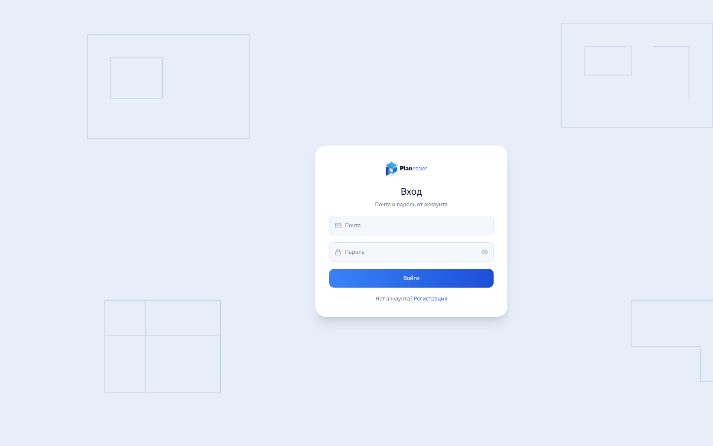
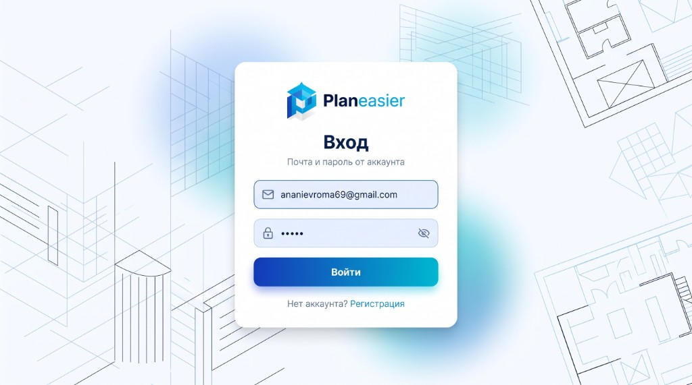
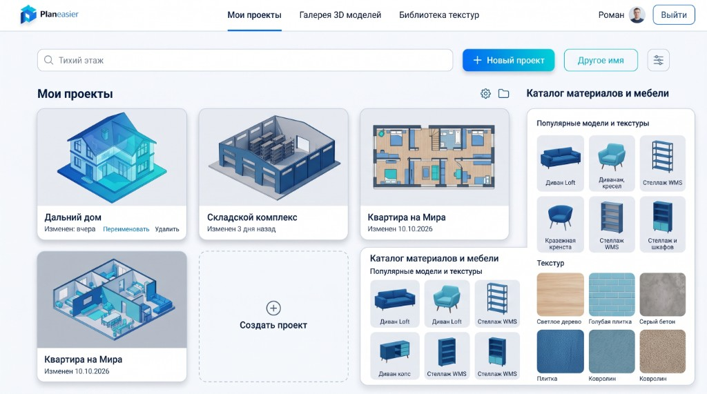

# Planeasier

Веб-планировщик комнат: стены, этажи, проёмы, мебель и персонаж от первого лица. Интерфейс кабинета сделан по макету светлой синей темы: карточки проектов, галерея моделей и библиотека текстур.

Похожие продукты, на которые опирается этот прототип: Planner 5D (магазин моделей и материалов, изометрические карточки), Sweet Home 3D (стыковка стен), Homestyler (библиотека отделки). Из библиотек используются three.js и `GLTFExporter` для выгрузки сцены, `@react-three/fiber` для предпросмотра, процедурный `CanvasTexture` для отделки. Наведение на плитки сделано переходами CSS (`transform` и тень), без отдельной анимационной библиотеки, чтобы не раздувать сборку.

## Как устроено

- Вход и регистрация: `/login`, `/register`.
- Проекты: `/projects`. Карточка показывает план под углом, а не сверху. Справа каталог моделей и текстур, которые уже есть на аккаунте.
- Галерея: `/gallery`. Пакет нажимается «Добавить» и записывается на аккаунт.
- Текстуры: `/textures`. То же для отделки.
- Редактор: `/editor/:id`. У объекта те же ручки размера, стрелки осей и поворот. В панели свойств, кроме цвета, выбирается текстура из купленных.
- Импорт `.glb`, `.gltf`, `.obj` кладёт модель в ту же систему размеров: её можно тянуть, крутить и красить.
- Кнопка glTF в шапке редактора сохраняет расставленные объекты файлом `.gltf`.
- Стена притягивается к концу соседней стены. Лестница и прочая мебель притягиваются к краям проёма или пола и отпускаются, если тянуть дальше зоны прилипания.
- Персонаж ходит по лестницам и проваливается вниз через проём в плите. Вне вида от первого лица камера едет на W A S D, Shift быстрее.

## Запуск

Из каталога `devops`:

```
docker compose up -d --build
```

Интерфейс: http://localhost:3000  
API: http://localhost:8005

Тестовый вход зависит от уже созданного аккаунта в базе.

## Проверки

В `frontend`:

```
npm test
npx tsc --noEmit -p tsconfig.app.json
```

`npm test` гоняет сценарий комнаты (пол закрывает стены, стены стоят на плите) и прилипание лестницы к проёму.

## Скриншоты

Экран входа собран по макету: светлый чертёжный фон, карточка, синяя кнопка.



Макеты, по которым собран кабинет:





## Ветка

Код этой версии лежит в `feature/catalog-studio`: https://github.com/bravialle52/planeasier/tree/feature/catalog-studio

Слияние с основной веткой не делалось.

## Тест-кейсы

1. Комната 5×4: четыре стены, пол шире наружного контура, низ стен совпадает с верхом плиты.
2. Угол ящика садится на шаг сетки, а не центр.
3. Лестница рядом с проёмом сдвигается к его краю. Далеко от проёма смещение нулевое.
4. Бесплатные пакеты (`sofa_loft`, `wood_light`) есть на каждом аккаунте. `bed_loft` появляется в спальне только после «Добавить» в галерее, с тем же названием, что в магазине.
5. Импорт `.glb` / `.obj` создаёт объект `custom` с теми же стрелками и гранями.
6. Кнопка glTF в шапке редактора скачивает расставленные объекты.
7. Клик по текстуре в панели свойств кладёт её на выделенный объект.
8. Персонаж над проёмом в плите проваливается вниз, а не встаёт на сплошной прямоугольник пола.

Пункты 1–4 проверяет `npm test`. Пункты 5–8 — сценарии редактора в браузере.
